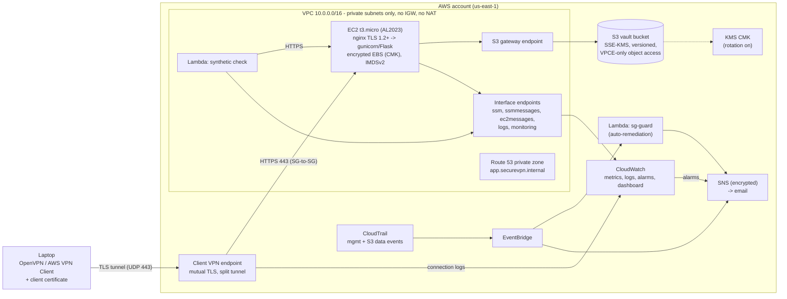

# Architecture and design decisions

## Diagram

## Request path

1. The user connects with a client certificate issued by the project's private CA. The Client VPN endpoint validates it against the CA chain imported into ACM. Revoked certificates are rejected through the imported CRL.
2. Split tunnel: only `10.0.0.0/16` is routed through the VPN. DNS goes to the VPC resolver, so `app.securevpn.internal` resolves through the private hosted zone.
3. Traffic leaves the VPN endpoint's ENI. That ENI's security group allows egress **only** to the app security group on 80/443. The app security group allows ingress **only** from the VPN and synthetic-check security groups.
4. nginx terminates TLS 1.2/1.3 using a certificate for `app.securevpn.internal` signed by the private CA. It sets HSTS, CSP and the other security headers, then proxies to gunicorn on localhost.
5. The Flask app reads and writes objects in S3 through the gateway endpoint, using SSE-KMS with the CMK. The bucket policy denies object access that does not arrive through that endpoint.

## Security controls matrix

| Threat | Control | Where |
|---|---|---|
| Internet attacker reaches the server | No IGW/NAT, no public IP, SG ingress only from the VPN SG | `vpc.tf`, `compute.tf` |
| Stolen VPN profile | Per-user client certs, revocation via CRL, connection logs, failed-connection alarm | `scripts/pki.sh`, `vpn.tf`, `monitoring.tf` |
| VPN user pivots to other hosts | VPN SG egress limited to app SG on 80/443 | `vpn.tf` |
| Eavesdropping | Mutual-TLS VPN tunnel, then HTTPS TLS 1.2+ end to end, S3 TLS-only policy | `vpn.tf`, `nginx.conf`, `storage.tf` |
| Leaked AWS keys used to read data | Bucket policy: object access only via the VPC endpoint | `storage.tf` |
| Disk / snapshot theft | EBS, S3, logs, SNS and SSM encrypted with a CMK, key rotation | `kms.tf` |
| Accidental deletion | S3 versioning (30-day noncurrent retention) | `storage.tf` |
| SSH brute force | No SSH at all; admin access through SSM Session Manager (IAM-authenticated, audited) | `compute.tf` |
| SSRF credential theft | IMDSv2 required, hop limit 1 | `compute.tf` |
| Someone opens a port to the world | sg-guard Lambda revokes it within minutes and emails an alert | `lambdas.tf` |
| Tampering with security config | EventBridge alert on SG/KMS/S3-policy/CloudTrail changes | `monitoring.tf` |
| Audit gaps | CloudTrail multi-region, log file validation, S3 data events | `security.tf` |
| Runaway cost | AWS Budget alerts at 80% actual and 100% forecast | `monitoring.tf` |
| Compromised app process | systemd sandbox (ProtectSystem=strict, NoNewPrivileges, no capabilities), least-privilege IAM | `vault.service`, `compute.tf` |

## Automated monitoring and self-healing

| Signal | Source | Automated response |
|---|---|---|
| Host hardware failure | `StatusCheckFailed_System` | **EC2 auto-recover** + email |
| Guest OS hang | `StatusCheckFailed_Instance` | **Automatic reboot** + email |
| App down | In-VPC synthetic Lambda every 5 min (verifies TLS cert) | Email; missing data counts as down |
| Slow app | Synthetic latency > 2 s | Email |
| CPU / memory / disk | EC2 + CloudWatch agent | Email |
| HTTP 5xx, app errors | nginx JSON log + app JSON log metric filters | Email |
| Bootstrap failure | user-data log metric filter | Email |
| VPN connection failures | Client VPN connection log metric filter | Email |
| Port-scan-like rejects | VPC Flow Logs REJECT metric filter | Email |
| World-open SG rule | CloudTrail -> EventBridge -> sg-guard | **Rule revoked automatically** + email |
| Security config change | CloudTrail -> EventBridge | Email |
| Threats (optional) | GuardDuty severity >= 4 | Email |

## Key design decisions

| Decision | Alternatives considered | Why |
|---|---|---|
| AWS Client VPN with mutual TLS | Site-to-Site VPN, self-managed OpenVPN/WireGuard on EC2 | Fully managed and highly available, native logging/metrics, no extra server to patch. Cert auth needs no directory service. |
| VPC endpoints instead of NAT gateway | NAT gateway (~$33/month + data) | No internet egress path at all (stronger isolation). The S3 gateway endpoint is free and also serves the AL2023 package repos. |
| Offline wheelhouse bundle | pip install from PyPI at boot | Works with no internet, reproducible (pinned lock file), immutable artifact in S3. |
| Immutable instances | In-place deploys over SSM | A new bundle hash changes `user_data`, so Terraform replaces the instance. No configuration drift. |
| One CMK | One key per service | Simpler key policy for a single-team project. All usage is still auditable per service via encryption context. |
| Single instance | ASG + internal ALB | Cost. Auto-recover/reboot covers hardware/OS failure. An ASG + internal ALB is the documented next step for HA. |
| Terraform | CloudFormation, CDK | Cloud-agnostic skill, clear plan/diff workflow, large module ecosystem. |

## Cost estimate (us-east-1, while deployed)

| Item | Hourly | Per day |
|---|---|---|
| Client VPN subnet association | $0.10 | $2.40 |
| Client VPN connection (while connected) | $0.05 | ~$0.40 (8 h) |
| 5 interface endpoints x 1 AZ | $0.05 | $1.20 |
| EC2 t3.micro (free tier eligible) | $0.0104 | $0.25 |
| KMS key, Route 53 zone, CloudWatch, S3, Lambda | - | ~$0.10 |
| **Total** | | **≈ $4.35/day** |

Run `make destroy` when you are not demoing. The whole stack rebuilds in about 10–15 minutes.

## Future work

- SAML/SSO (IAM Identity Center) federated VPN authentication with per-group authorization rules.
- Auto Scaling group across two AZs behind an internal ALB, with AWS WAF.
- AWS Backup plan for EBS, and S3 Object Lock for compliance-grade immutability.
- AWS Config conformance pack and Security Hub for continuous compliance scoring.
- GitHub Actions OIDC role to run `terraform plan` on pull requests.
